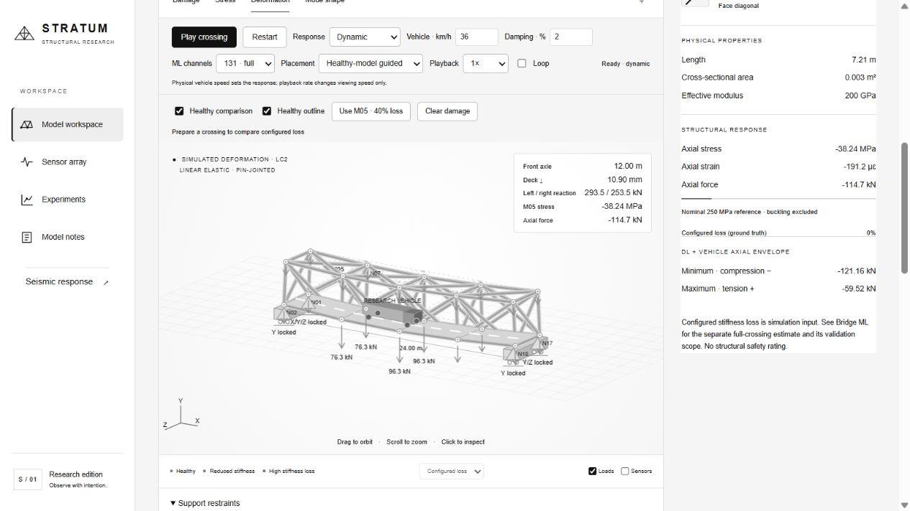
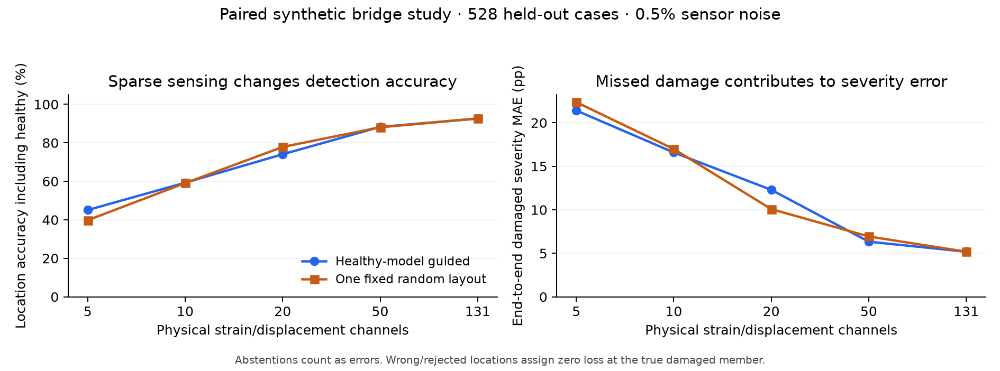

# STRATUM

Finite-element analysis, damage estimation, and sparse sensing for truss bridges.

STRATUM models planar and space trusses, simulates a moving load on a 24 m bridge, and estimates member stiffness loss from virtual strain and displacement measurements. A browser workspace provides model inspection, load playback, response plots, and exports.

**Author:** [Atharv Sharma](AUTHORS.md) · [Results](docs/RESULTS.md) · [Reproduction guide](docs/REPRODUCIBILITY.md) · [Source guide](START_HERE.md)

[](https://github.com/Valomaxed/stratum/actions/workflows/tests.yml)

## Application



Bridge geometry, support restraints, calculated member response, and moving-load controls. Configured damage is a simulation input; the separate ML workflow estimates damage from measured response channels.

## Methods

- **Mechanics:** 2D/3D axial-truss FEM, support elimination, reaction recovery, modal analysis, and prescribed moving-force dynamics.
- **Estimation:** Random Forest classification and regression for bridge damage; separate physics-based inverse methods for the planar study.
- **Sensing:** Channel selection and paired comparisons across sensor budgets, using selected channel histories as model inputs.

## Recorded bridge results

The baseline contains 3,520 synthetic cases, split before noise augmentation into 2,464 training, 528 validation, and 528 test cases. The table uses the same 528 held-out cases and noise draws at 0.5% sensor noise.

| Channels | Guided location accuracy | Fixed-random accuracy | Guided severity MAE (percentage points) |
|---|---:|---:|---:|
| 131 | 92.61% | 92.61% | 5.18 |
| 50 | 88.26% | 88.07% | 6.34 |
| 20 | 74.05% | 77.84% | 12.29 |
| 10 | 59.28% | 59.09% | 16.59 |
| 5 | 45.08% | 39.77% | 21.41 |

Fifty guided channels reduce the channel count by 61.8%, with lower accuracy than the full array. Only the 131-channel layout met the predefined validation qualification rule. Guided placement does not outperform the fixed-random comparator at every budget. Abstentions count as errors.



Definitions, acquisition conditions, coverage, healthy alarms, and raw report links are in [Results](docs/RESULTS.md).

## Run locally

Use Python 3.12 or 3.13.

```sh
git clone https://github.com/Valomaxed/stratum.git
cd stratum
python -m venv .venv
```

Windows PowerShell:

```powershell
.\.venv\Scripts\python.exe -m pip install -r requirements.txt
.\.venv\Scripts\python.exe examples/quick_review.py
.\.venv\Scripts\python.exe -m twin serve --host 127.0.0.1 --port 8766
```

macOS/Linux:

```sh
.venv/bin/python -m pip install -r requirements.txt
.venv/bin/python examples/quick_review.py
.venv/bin/python -m twin serve --host 127.0.0.1 --port 8766
```

Open [localhost:8766](http://127.0.0.1:8766/). The numerical example and FEM viewer run without trained ML artifacts. The ML panels report unavailable models until the training workflow in the [reproduction guide](docs/REPRODUCIBILITY.md) has been run.

## Verification

```sh
python -m unittest tests.test_fem tests.test_space tests.test_bridge tests.test_bridge_dynamics -v
node --test tests/bridge-playback.test.cjs
```

The [complete CI workflow](.github/workflows/tests.yml) adds service, estimation, support-audit, and playback checks. Verification covers analytical solutions, force/moment and energy balance, modal equations, independent ODE calculations, and time-step refinement. Artifact-dependent tests explicitly skip when their training files are absent.

## Scope

The bridge uses linear, small-displacement axial members and prescribed moving forces. It excludes local deck bending, vehicle suspension, contact/uplift, nonlinear buckling, and capacity/code assessment. ML results describe the documented synthetic acquisition family; physical transfer and multi-member bridge damage require further evaluation. The stiffness index is not a safety rating.

## Code and documentation

| Path | Contents |
|---|---|
| `twin/` | FEM, dynamics, sensing, estimation, and HTTP API |
| `web/` | Browser model, plots, inspection, and playback |
| `tests/` | Numerical, service, and regression checks |
| `examples/` | Small numerical examples and report plotting |
| `data/` | Versioned results, verification reports, and screenshots |
| `unity/` | Optional Unity viewer |

[Architecture](docs/ARCHITECTURE.md) · [Research protocol](docs/RESEARCH.md) · [Support audit](data/support-review.md) · [Contributing](CONTRIBUTING.md) · [Citation](CITATION.cff)

The independent frame-analysis project is [STRATUM Seismic](https://github.com/Valomaxed/stratum-seismic).
