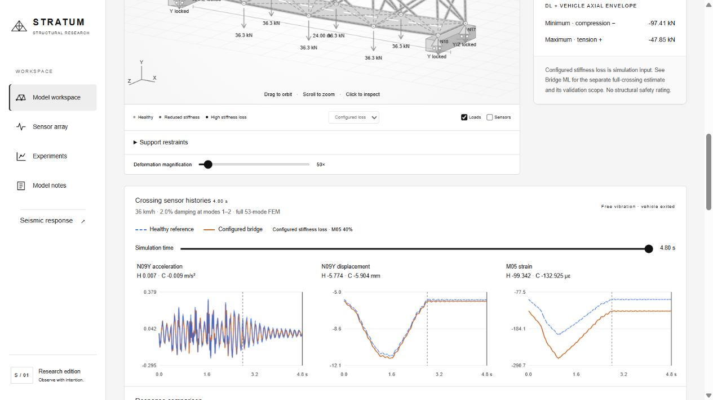

# STRATUM — Structural digital twin

Interactive structural research software combining Python FEM, simulated sensing, machine learning damage estimation, and a browser-based 3D bridge viewer. Includes an optional Unity client and an elastic seismic frame comparison workspace.



## Run locally

Requires Python 3.10 or newer. From the repository folder:

```powershell
python -m venv .venv
.\.venv\Scripts\python.exe -m pip install -r requirements.txt
.\.venv\Scripts\python.exe -m twin serve --host 127.0.0.1 --port 8766
```

Open **http://127.0.0.1:8766/** for the digital twin and **http://127.0.0.1:8766/seismic.html** for seismic comparisons. The interface uses Arial and a black/white/gray theme with colored graph traces and matching legends. See [Unity setup](unity/README.md) for the separate editor client.

**Repository contents:** source code, tests, example ground motion with provenance, selected screenshots, and research reports. Large trained forests, generated datasets, Python environments and Unity caches are excluded. FEM visualization and seismic analysis can run without trained models; ML estimation reports unavailable until the relevant artifacts are regenerated. Saved numerical verification reports are tied to source hashes and their original environment.

To regenerate ML artifacts, run the commands below as needed; these are research jobs and can take several minutes or longer:

```powershell
.\.venv\Scripts\python.exe -m twin train
.\.venv\Scripts\python.exe -m twin study
.\.venv\Scripts\python.exe -m twin robust-study
.\.venv\Scripts\python.exe -m twin bridge-train --workers 2
.\.venv\Scripts\python.exe -m twin bridge-sparse-study --workers 2
```

The sparse bridge study depends on the preceding bridge training run. Optional OpenSees verification has a separate dependency list in `requirements-verification.txt`; it is not needed to use the app. Model assumptions, validation scope and experiment details follow below. This repository does not certify structural safety or code compliance.

Support/calculation review (29 October 2026): [review and validation scope](data/support-review.md), [numerical audit](data/support-review.json). The browser UI now uses Arial and a black/white/gray theme. Reproduce the support audit with `python -m twin.support_audit`.

A working local research prototype that connects **truss FEM → virtual sensing → random forest / physics inverse fitting → interactive browser and Unity viewers**.

The structure selector includes a **24 m × 4 m × 4 m braced steel space truss**, with 20 joints, 78 members, 54 free translational degrees of freedom, and 132 virtual strain/displacement channels. A structure selector switches to the original **24 m × 4 m planar truss**, with 10 nodes, 21 members, and 38 channels. Browser and Unity clients support both geometries.

## Current milestone: sparse bridge sensing and paired placement study

The browser now has separate **ML channels** (131, 50, 20, 10, 5) and **Placement** controls for dynamic crossings. Choose **Healthy-model guided** or **Fixed random layout**, then run the same crossing. These controls are separate from the stationary three-load sensor budget in Edit scenario. The ML result still appears only after the complete crossing plus 2 s tail; it reports the selected budget and its own held-out metrics. Unsupported budgets, dropout, drift or non-default crossing conditions remain outside scope.

**Selected ML channels** lists the strain gauges and displacement axes used by the chosen model. Enable **Sensors** on the 3D viewer to see that layout during playback. A displacement axis counts as one physical channel; each channel contributes 20 phase observations. The three clean reference plots remain N09Y acceleration/displacement and M05 strain, whether or not those channels belong to the ML layout. The sensor-grid tab retains the available virtual field and stationary masks; it does not imply that every channel is used by sparse ML. Exports identify the selected layout separately.

`python -m twin bridge-sparse-study --workers 2` reuses the original frozen dataset, model and split. It does not regenerate or overwrite the baseline. For placement, a healthy-only dynamic sensitivity is computed from a 2% perturbation along each of the 78 member-loss directions. Greedy grouped D-optimal selection adds whole physical channels with all 20 readings, using regularization 0.01. This is a local information heuristic, not a globally optimal layout. The random comparison uses one nested permutation (seed 481026), rather than a distribution over random layouts.

Each reduced budget/placement trains its own forests using **only the selected channel histories** and their channel mean/RMS features (22 features per channel). Unselected readings cannot enter features or a hidden full-array prediction. Classifier/regressor hyperparameters, training cases and every sensor-noise draw match the original full-array protocol. Classifiers use 180 trees, regressors 160, with the same original seeds. The 131-channel reference is the unchanged original forest for both placement labels. Sensor selection uses only healthy physics; class-vote thresholds are selected using validation data. All layouts, forests, thresholds and the recommended budget are frozen before sparse-test evaluation.

The predefined recommendation is the **smallest tested guided budget** reaching at least 90% validation location accuracy, 95% coverage and at most 5% healthy alarms at 0.5% noise. It is not a universal minimum sensor count. The comparison reuses the original 528 held-out scenarios with identical noise at 0%, 0.5% and 1%; it is a paired extension of that synthetic experiment, not a fresh physical validation. Accuracy counts abstentions as failures; severity error assigns zero at a true damaged member when missed or rejected. The report includes coverage and healthy false alarms alongside accuracy.

The completed paired audit at **0.5% noise**, on the same 528 held-out cases:

| Channels | Guided location accuracy | Fixed random accuracy | Guided coverage | Guided damage MAE |
|---|---:|---:|---:|---:|
| 131 | 92.61% | 92.61% | 100.00% | 5.18 pp |
| 50 | 88.26% | 88.07% | 100.00% | 6.34 pp |
| 20 | 74.05% | 77.84% | 98.86% | 12.29 pp |
| 10 | 59.28% | 59.09% | 86.93% | 16.59 pp |
| 5 | 45.08% | 39.77% | 73.11% | 21.41 pp |

Only the **131-channel** guided layout met the predefined validation qualification rule; this study does not establish a reduced sensor count that retains 90% accuracy. Fifty guided channels reduced the channel count by about 62% with test location accuracy 88.26%. The guided heuristic did not outperform the single random layout at every budget (20 random channels performed better here). These results do not justify changing the target after seeing the test data. Full coverage does not imply correct detection, and the low-budget conditional accuracy differs from accuracy that counts abstentions as failures.

Artifacts in `data/bridge-sparse/`: `placement.json` and channel catalog, `healthy-sensitivity.npz`, eight reduced-budget forest pairs under `models/`, `selection.json`, `report.json` and `test-predictions.npz`. Geometry/protocol, placement, frozen selection and forest hashes guard inference. The browser caches only the active reduced model and retains the original full-array baseline. The report is available through `GET /api/bridge-sparse-report` and the ML panel's **Sparse sensing experiment** section.

API: add `bridge_ml: {"sensor_count": 20, "placement": "guided"}` to `POST /api/bridge-playback`. `sensor_count` at the top level remains the stationary budget; old callers without `bridge_ml` use it as their ML budget for compatibility. Results include `sensor_indices`, `selected_channels`, budget-specific evaluation and the paired sparse-study summary. The original `BridgeDamageEstimator` remains a full-array estimator; sparse inference is handled separately.

```powershell
.\.venv\Scripts\python.exe -m twin bridge-sparse-study --workers 2
.\.venv\Scripts\python.exe -m unittest tests.test_bridge_sparse tests.test_bridge_learning -v
```

## Previous milestone: bearing audit and first dynamic bridge ML baseline

The existing bridge boundary conditions were checked and retained: **N01 XYZ**, **N02 Y**, **N17 YZ**, **N18 Y**. X is along the span, Y vertical, Z transverse. N01 anchors translations; N17 is a longitudinally guided expansion bearing; N02/N18 permit X/Z movement. Tests verify restraint rank six for the six rigid-body motions, positive free stiffness, equilibrium for X/Y/Z loads, and compatibility with uniform expansion about N01. Four vertical bearing restraints are intentional. The viewer's reaction table now distinguishes bearing type, blocked and free translation axes. This is an idealized axial-truss bearing system: it does not design physical bearings or model bearing rotations, friction, uplift/contact, substructure flexibility or settlement. See the [FHWA bearing-system guidance](https://www.fhwa.dot.gov/bridge/pubs/nhi15047.pdf) for the distinction between fixed, guided and free expansion bearings and the need for a consistent movement system.

`python -m twin bridge-train` generates bridge-specific dynamic crossing measurements and trains separate Random Forest models for **healthy/member classification** and **single-member stiffness-loss regression**. The model consumes 78 strain and 53 free-displacement channels at 20 known crossing/tail times (15 vehicle positions, five tail times). Its 2,882 features are normalized healthy-reference measurement differences plus channel mean/RMS summaries. **Configured damage, effective E, stresses, modal frequencies and comparison labels are excluded from the feature path.** A known linear load multiplier is normalized out.

The initial baseline uses the default axle/deck/lane configuration, **36 km/h**, **2% target damping**, complete 131-channel coverage, and healthy or **one damaged member with 8–65% stiffness loss**. Speed/loading changes, sparse budgets, dropout, drift or noise above 1% return an explicit out-of-scope result. Multiple damage, other severity ranges, contact physics and real hardware are not validated. No planar forest is reused. Independent Gaussian phase-sample noise is scaled by the healthy per-type response peak; this new full-crossing acquisition is separate from the static sensor grid's noise/masks and the three clean plotted sensor histories.

The default run comprises 3,120 damaged configurations (40 per member) plus 400 healthy noise-replicate cases. Healthy replicates share one physical zero-loss state; they are not 400 distinct structures. Cases are stratified into training/validation/test before adding noise. Three training packets per training case cover clean, 0.5% and 1% noise. A winning-vote abstention threshold is selected on validation data, then the policy and forest are saved before evaluating held-out test cases at those three noise levels. The report includes location accuracy, damaged-location accuracy, coverage, healthy false alarms, end-to-end damaged severity error, conditional severity error and per-member accuracy. Abstentions count as accuracy failures. Severity error assigns zero to a missed/rejected true damaged member. Forest class votes are uncalibrated, not engineering damage probabilities.

After a supported dynamic crossing completes its 2 s vibration tail, **Bridge ML damage estimate** displays the result or an abstention. **Inspect predicted member** selects the candidate; configured damage colors remain simulation input. Scrubbing to the end analyzes the complete precomputed crossing. Looping can retain the last completed crossing result; edits/restart clear it. The validation details are available below the estimate. Browser exports include the completed-crossing ML result. Static bridge inference remains unavailable; the planar inference UI is unchanged.

The completed run used **2,464 training cases, 528 validation cases and 528 held-out test cases** (7,392 augmented training packets). Validation selected a winning-vote threshold of **0.20**. Held-out results:

| Test noise | Location accuracy incl. healthy | Damaged-member location | Coverage | Healthy false alarms | Damaged severity MAE |
|---|---:|---:|---:|---:|---:|
| 0.0% | 100.00% | 100.00% | 100.00% | 0.00% | 0.80 pp |
| 0.5% | 92.61% | 91.67% | 100.00% | 0.00% | 5.18 pp |
| 1.0% | 92.42% | 91.45% | 99.81% | 0.00% | 7.86 pp |

Each test condition includes 468 single-damage cases (six per member) and 60 healthy noise replicates. Test metrics were not used to retune the frozen model. Per-member failures are included in the full report; these percentages do not establish real-bridge accuracy.

Artifacts are in `data/bridge-ml/`: `dataset.npz` (normalized measurement packets, labels, severity, split), `forest.joblib`, `selection.json` (validation policy), `report.json`, and `test-predictions.npz`. A signature binds geometry, member layout, supports, mass/stiffness and feature protocol to the forest; the loader also checks the forest file hash. Same-FEM synthetic evaluation is not validation on a physical bridge or an unseen geometry.

```powershell
.\.venv\Scripts\python.exe -m twin bridge-train --cases-per-member 40 --healthy-cases 400 --workers 4
.\.venv\Scripts\python.exe -m unittest tests.test_bridge tests.test_bridge_learning -v
```

## Previous milestone: healthy versus configured-damage comparison

In the browser bridge viewer, **Healthy comparison** overlays the healthy reference on the configured dynamic crossing. The same axle forces, lane, vehicle speed, deck line load/mass, geometry and load multiplier are used in both states. Their damping ratios target the first two modes separately, as in the existing dynamic model. **Use M05 · 40% loss** replaces configured member losses with that example and starts a fresh crossing; **Clear damage** removes all losses and reruns. Edit scenario still supports custom single/multiple damaged members. These are configured FEM scenarios, not ML detections.

The acceleration/displacement/strain plots share axes and time cursor: **dashed blue = healthy**, **solid ochre = configured**. Readouts show H and C values at the same physical time. Each trace retains its own integration grid; the healthy signal is not resampled onto a coarser damaged-model grid for peak statistics. The optional **Healthy outline** draws the healthy deformed shape in dashed blue at the same magnification as the current structure, in Deformation view. Damaged members retain their configured loss colors/labels, with clickable member chips in the report. Switching comparison off hides the reference plots, report and outline without rerunning or changing damage.

**Response comparison** lists the peak absolute N09Y acceleration, N09Y vertical displacement and M05 axial strain, plus the first four natural frequencies, with healthy/configured values and signed percent change. Channel peaks cover the entire crossing plus the 2 s vibration tail and include dead-load offsets. They are fixed-channel metrics, not global bridge maxima; a damaged state's response can decrease at a particular sensor. A zero baseline gives no percent change rather than dividing by zero. With no damage, both histories coincide and nonzero metrics have zero change.

The dynamic playback API now also returns `healthy_signal`, `healthy_displacement` aligned to the scene frame times, and `comparison` with channel/frequency rows, configured member losses, healthy integration diagnostics and assumptions. Browser JSON exports include both dense channel histories and the comparison report. The existing quasi-static method and planar inference remain separate. Unity retains static bridge controls.

Verification adds healthy-state identity, independent healthy-reference equivalence under eccentric loading and changed deck mass/load scale, native-time-grid consistency, channel peak/frequency checks, zero-baseline handling and member-removal metadata. Browser checks cover the damage example, clear-damage control, toggles, synchronized scrubbing, responsive layout and planar model switching.

```powershell
.\.venv\Scripts\python.exe -m unittest tests.test_bridge_dynamics tests.test_playback -v
node --test tests/bridge-playback.test.cjs
```

## Previous milestone: dynamic moving-force bridge crossings

The browser now defaults to **Dynamic** moving-load response. Set **Vehicle · km/h** (10–120; default 36), **Damping · %** (0–10; default 2) and **Play crossing**. Physical speed changes the applied force history and calculated vibration. **Playback 0.5× / 1× / 2×** changes viewing speed only. Pause, restart, loop, member picking and the original position slider remain available. **Quasi-static** retains the previous static playback. Editing the method, physical speed, damping, loads or damage invalidates the prepared crossing.

Python integrates `M a + C v + K u = F_dead + F_vehicle(t)` using [Newmark average acceleration](https://opensees.github.io/OpenSeesDocumentation/user/manual/analysis/integrator/Newmark.html) (gamma=1/2, beta=1/4), in the complete mass-normalized 53-mode basis. No modal truncation is used. Rayleigh damping targets the selected ratio at the first two modes of each modeled state. The step is at most 1 ms and resolves the highest mode with at least 30 steps per cycle. The initial displacement is settled dead-load equilibrium, with zero velocity and acceleration; two seconds of unloaded free vibration follow the rear axle's exit. At 36 km/h the crossing lasts 2.8 seconds, followed by the 2-second tail.

**Crossing sensor histories** shows clean FEM acceleration and signed vertical displacement at **N09Y** (left midspan deck joint), and axial strain at **M05**. A shared cursor and instant values follow the truck. Scrub **Simulation time** to inspect the crossing or vibration tail. The future trace is deliberately shown faded; it is precomputed simulation, not a live hardware measurement or ML forecast. Plots retain dense integration samples and use min/max display bins to preserve brief peaks; scene fields use roughly 5 ms presentation samples with linear interpolation. Frame interpolation can introduce a small displayed balance residual near load-transfer events; the export also includes the actual integration residual and time step.

The current stress, strain, axial force, displacement, loads and reactions follow the dynamic solution. Reactions use `M a + C v + K u - F`, including support contributions from Rayleigh damping. The displayed vertical residual subtracts inertia and damping. The healthy deflection comparison uses a separately integrated healthy crossing with the same speed and damping target. The vehicle-position envelope and bearing min/max remain explicitly **static**. The older **Response signature / LC1 dead-load pulse** is a separate excitation, clearly labeled; it is not the crossing history. Configured sensor errors/masks remain fixed during a pass, while the new plots show clean channels. Stationary three-load ML and sensitivity results are not recomputed from dynamic samples, and bridge damage inference remains unavailable.

This is **bridge dynamics under prescribed moving axle forces**. Vehicle mass, suspension, road roughness, tire contact, coupled vehicle–bridge dynamics, code impact factors and local deck bending are excluded. Vehicle speed is constant within each crossing. Unity retains static bridge controls; this milestone is in the browser.

API: `POST /api/bridge-playback` with `model_id: "bridge"`, `method: "dynamic-moving-force"`, optional `dynamic: {"speed_kmh": 36, "damping_ratio": 0.02}`, and the existing bridge/damage/load parameters. Omitting `method` preserves the earlier quasi-static API. Dynamic exports include method, physical speed, simulation time, clean sensor histories, integration metadata and modeling assumptions. Loop repeats independent crossings from dead-load equilibrium; it does not model a continuous train of vehicles.

Validation includes an independent physical-DOF SciPy DOP853 integration, time-step halving, dynamic equilibrium, fixed-support constraints, initial dead-load equilibrium, zero-vehicle invariance, damage response and post-exit vibration. JavaScript tests verify the actual browser sampler's energy, reactions, force balance and time mapping. These are numerical research checks, not commercial-solver or hardware validation.

```powershell
.\.venv\Scripts\python.exe -m unittest discover -s tests -p test_bridge_dynamics.py -v
node --test tests/bridge-playback.test.cjs
```

## Previous milestone: animated quasi-static moving-load playback

In the browser bridge viewer, select **Play crossing** to animate the vehicle from entry to exit. **Pause / Resume**, **Restart**, **0.5× / 1× / 2×**, and **Loop** control playback (nominally 12 seconds per pass at 1×). The first playback selects dead + vehicle and shows magnified deformation unless stress view is already selected. Camera controls and member selection remain interactive. Scrubbing the position slider or using the metre arrows pauses and samples the prepared response immediately; parameter/damage edits invalidate it and the next Play prepares a fresh crossing.

The truck position, load arrows, displacement/deformed geometry, selected member stress/strain/axial force, bearing reactions, current deck-joint deflection and envelope marker update together. A compact readout beside the model keeps position, deflection and abutment reactions visible. Playback freezes on hidden-page navigation; moving to another workspace tab also pauses it. Selecting Mode shape pauses moving-load playback because that animation is a separate modal visualization.

This is **quasi-static moving-load playback**, not an inertial vehicle/bridge simulation. Python prepares displacement, strain and resisting nodal forces at axle/panel events and intermediate plotting positions. For fixed stiffness and this linear panel-load transfer, these response fields interpolate linearly between events. The browser rebuilds actual axle forces at the exact position and calculates reactions as K*u − F, preserving the jump when an axle leaves a bearing. Fresh-FEM comparisons test both interpolation and these entry/exit cases. Peak displacements and stresses are recomputed from the current fields rather than interpolating their maxima.

Virtual sensor masks and the initial measurement error offsets are held fixed during each crossing; the LC2 channel values follow the current FEM response with those offsets. Run analysis for a fresh measurement packet. Sensitivity rank is marked unavailable during playback and is recomputed by stationary analysis. Modal frequencies and the explicitly labeled LC1 dead-load pulse remain independent of the moving vehicle; vehicle mass, dynamic impact and inertia have not been added. Exports identify the data as `simulated-playback` and record these assumptions.

`POST /api/bridge-playback` accepts the same bridge geometry/damage/load settings and returns event-resolved response fields. It requires `model_id: "bridge"`. Prepared frames are invalidated on model changes, load/measurement edits or a new stationary analysis; playback never reuses a different damage state. The browser handles each display frame locally, so one crossing does not require a stream of HTTP analyses. Unity retains its static bridge controls in this milestone.

```powershell
.\.venv\Scripts\python.exe -m unittest discover -s tests -p test_playback.py -v
node --test tests/bridge-playback.test.cjs
```

## Previous milestone: static truss-bridge analysis

The dashboard now defaults to **3D · 24 m steel truss bridge**. This is a separate model from the space-truss demo: it has four bearings (N01 XYZ, N02 Y, N17 YZ, N18 Y), 20 joints, 78 axial members, 53 free translations and 131 virtual sensor channels. The visible deck is an idealized load-transfer surface; no beam or plate stiffness has been introduced.

- **Dead load:** steel member self-weight using g = 9.80665 m/s², plus a configurable deck line load (default 10 kN/m). Declared deck mass also enters the modal mass matrix; vehicle mass does not.
- **Research vehicle:** two configurable axles (default front 80 kN, rear 120 kN, spacing 4 m). Front-axle position ranges from 0 to span + axle spacing. Axles outside the span apply no force. Lane offset ranges from −1.2 to +1.2 m. Bilinear transfer to adjacent bottom panel joints preserves resultant vertical force and its longitudinal/transverse moments.
- **Load cases:** LC1 dead; LC2 dead + static vehicle; LC3 dead + transverse wind (default total 50 kN on upper joints). The global load multiplier scales the displayed loads and sweep consistently. These are unfactored research cases, not code combinations.
- **Outputs:** member stress/strain/axial force, true XYZ displacement, deck-joint downward deflection compared with the healthy bridge under the same load, four-bearing XYZ reactions, left/right abutment totals, and vertical equilibrium residual.
- **Vehicle-position envelope:** dead + vehicle is solved independently at every axle/panel crossing plus a 0.5 m plotting grid and the current position. Reported values include peak deck-joint downward deflection and governing front-axle position, signed member axial min/max and bearing vertical min/max. The sweep always means DL + vehicle, even when the current display is dead-only or wind. It is a sequence of static solves, not a traffic time-history simulation.

Move the front axle with the slider (analysis updates on release) or the one-metre arrows. Expand **Vehicle, deck and wind parameters** to edit loads, then **Apply loads**. **Edit scenario** still configures member stiffness loss and virtual sensor conditions. **Show deck surface** reveals/hides the road plane for member inspection. The browser and Unity clients both render the bridge and research vehicle; Unity cycles through space → bridge → planar via its Structure button and applies position/parameter changes with Run analysis.

Validation checks include exact axle force/moment preservation, self-weight and deck mass consistency, abutment reactions against elementary statics, envelope bounds against independent random-position solves, partial entry/exit, zero-live-load envelopes, and API parameter validation. The existing 2D and 3D tests remain applicable. The Unity headless check now covers bridge bearings and envelope consistency between its space-truss and planar regression phases.

**Limits:** this is axial truss-level bridge research, not complete bridge design. Local slab/floor-beam bending, connection design, nonlinear buckling, fatigue, bearing contact/uplift behavior, vehicle dynamics/impact, load factors and design-code capacity checks are excluded. Bridge ML damage inference is not trained; configured loss is simulation input. The acceleration plot is a separate dead-load pulse and must not be interpreted as the moving vehicle response.

```powershell
.\.venv\Scripts\python.exe -m unittest discover -s tests -p test_bridge.py -v
```

For `POST /api/analyze`, use `model_id: "bridge"`, `protocol: "multi"`, `display_case: "LC2"` and an optional `bridge` object with `vehicle_position_m`, `front_axle_kn`, `rear_axle_kn`, `axle_spacing_m`, `lane_offset_m`, `deck_load_kn_m`, and `wind_total_kn`. The response adds `bridge.current`, `bridge.vehicle`, `bridge.supports`, `bridge.sweep`, and modeling assumptions. Existing API clients still default to `planar` when `model_id` is omitted.

## Previous milestone: true 3D FEM and visualization

The space truss has four 6 m bays, four longitudinal chords, X-bracing on both side faces and the top/bottom faces, and braced cross-sections. Coordinates use X longitudinal, Y vertical, Z transverse. Bearings restrain N01 in XYZ, N02 in XY, and N17 in Y: six rigid-body restraints in total. All members use E = 200 GPa, A = 0.003 m², density = 7850 kg/m³. Added nodal mass is 600 kg at six loaded bottom joints and 200 kg elsewhere, plus lumped member mass.

- **LC1:** six bottom joints each carry 37.5 kN downward (225 kN total).
- **LC2:** three upper joints on one side each carry 75 kN downward (225 kN total, eccentric across the width).
- **LC3:** every upper joint carries 5 kN longitudinally and 15 kN transversely (50 kN in X and 150 kN in Z total).

Use **Structure → 3D · Braced steel space truss**, then **Edit scenario** to select any of 78 members, change stiffness loss, choose loading and sensor conditions, and run. The viewer supports orbit, pan, zoom, member inspection, stress, true XYZ deformation and animated XYZ mode shapes. All 132 candidate virtual sensors can be shown; a budget supplies the same physical channels across three independent acquisitions. The acceleration plot remains a separately simulated LC1 pulse at A09Y, even when LC2/LC3 static response is displayed. Switching structures starts a fresh scenario. The 3D default deformation magnification is 50×.

**3D damage inference is not trained or validated yet.** Configured loss is ground truth, not a detected result. The space model never loads the planar forests or sparse refinement policy, and its estimated-loss/refinement controls are disabled. Research reports and their accuracy figures apply only to the original planar model. Next: generate independent 3D training/validation/test cases, train geometry-specific models, and validate sparse sensing/noise robustness before enabling predictions. No beam/frame elements, buckling or hardware validation have been added.

Numerical verification includes a three-inclined-bar tripod with a closed-form displacement solution and oblique rotation invariance; 3D force/moment balance under all load cases; support constraints; energy/work consistency; mass-orthogonal modes and eigen-equation residuals; damage-induced frequency reduction; and transient equilibrium. API checks verify Z displacement/load components, three-component mode shapes, 78-member editing, sensor budgets, planar compatibility, and refusal to use planar inference on 3D data. These are analytical and invariant checks, not an external commercial-solver comparison.

```powershell
.\.venv\Scripts\python.exe -m twin demo --model space
.\.venv\Scripts\python.exe -m unittest discover -s tests -p test_space.py -v
```

`GET /api/models` returns geometry, channel counts, support axes, and excitation metadata (`bridge` is the browser default). Add `"model_id": "space"` or `"model_id": "planar"` to `POST /api/analyze`; omitting it retains the planar API default for compatibility. The response adds `model_id`, `dimension`, `model` metadata, XYZ nodal displacements, `fz` loads, per-member `kind`, and an identified acceleration sensor. External observation inference remains planar-only.


## Planar milestone: noise-aware sparse refinement

The browser and Unity now offer **Noise-aware sparse physics** alongside the legacy all-parameter fit. Enable Physics refinement and select the method. The random forests remain frozen; this is a new inverse model selection step, not a newly trained classifier or a PINN.

The method fits the healthy model, each of 21 possible single-member hypotheses, and pairs within the six best single-member residual fits. Each candidate profiles one common additive normalized sensor offset (bounded to ±20%). Selection minimizes `RSS / σ² + λ · k · log(n)` where k is the number of member-loss parameters and n is the observed reading count. σ is a declared per-channel noise standard deviation after per-type/per-load normalization; a 0.01% numerical floor handles clean synthetic data. The profiled offset is a nuisance parameter shared by every candidate. Failed candidate fits are discarded; the healthy candidate remains available. This is a restricted sparse search, not exhaustive search over all possible damage configurations.

### Validation and fresh audit

A separate set of **120 new validation damage cases** (seed 31027) selected λ from 0.5, 1, 2, 4 and 8. The objective maximized mean exact damage-set accuracy across all four sensor budgets and three measurement conditions, subject to a mean healthy false-alarm target ≤5%. Selected penalties: **single-load 4; three-load 2**. That is a validation target, not a guaranteed test bound.

The selected configuration was saved and hashed **before generating 240 fresh test cases** (seed 41027), distinct from both forest training and the preceding excitation experiment. All three methods use identical packets, masks, sensor layouts and frozen forests. Every test case is evaluated in each reported condition. Three-load results at 1% Gaussian noise and 10% persistent sensor dropout:

| Physical sensors | RF exact location | Legacy fit exact location | Sparse exact location | Healthy false alarms: legacy → sparse | Damaged-member MAE: legacy → sparse |
|---|---:|---:|---:|---:|---:|
| 5 | 50.0% | 0.4% | 52.5% | 100.0% → 5.8% | 13.40 → 17.40 pp |
| 10 | 63.3% | 0.0% | 76.7% | 100.0% → 9.6% | 4.63 → 6.34 pp |
| 20 | 71.3% | 26.3% | 91.3% | 73.1% → 5.8% | 1.58 → 2.34 pp |
| 38 | 71.3% | 43.8% | 95.0% | 53.8% → 1.9% | 1.07 → 1.73 pp |

Each row uses the same 240 test cases, including **52 healthy cases**. Exact location requires every damaged/healthy member label to match. Fewer false alarms do not imply more accurate severity: sparse fitting misses some weak damage and generally increases damaged-member severity MAE relative to the dense fit. It also slightly reduces clean full-array location accuracy (100% → 97.9%). At 10 sensors in the noisy condition, the paired case-bootstrap location gain over the legacy fit is **76.7 pp**, with a **95% interval 71.7–82.1 pp**. Intervals cover paired test-case variation only, not forest-training variability or selection uncertainty.

Noise must be characterized: with 10 sensors and true noise 1%, declaring σ=0.5% increases healthy false alarms to **59.6%**; σ=2% reduces them to 0% but increases damaged-member MAE to **8.85 pp**. Correctly declaring σ=1% gives 9.6% healthy false alarms and 6.34 pp damaged-member MAE. These noise-assumption checks were performed after freezing the policy.

The method assumes **zero, one or two damaged members**, a known noise scale, the modeled loading/materials, and a common normalized offset. More extensive damage, per-sensor drift, outliers, correlated/non-Gaussian noise, environmental changes and real hardware remain outside this validation. No classifier probabilities were calibrated. Live forest votes remain separate from the sparse fit.

Reproduce:

```powershell
.\.venv\Scripts\python.exe -m twin robust-study --validation-cases 120 --test-cases 240 --workers 2
```

Artifacts in `data/robust-study/`: `config.json` (frozen settings and forest hashes), `report.json`, `dataset.npz`, `validation-predictions.npz` and `test-predictions.npz`. The API checks the frozen config digest, forest digest and sensor signature before enabling sparse refinement. Retraining the excitation forests requires a new robust validation run. `start.ps1 -Robust` repeats the study; `-Study` regenerates both excitation and robustness studies. Restart the server after either run. The UI Research selector retains the older excitation comparison.

## Previous milestone: independent loading tests

The default dashboard now combines **three independent, settled static load cases** measured with the same physical sensors. Each case alone has a healthy sensitivity rank of 17/21. Stacking all three reaches **21/21**, with a full-array normalized condition number of about **17.97** (relative SVD tolerance 1e-8).

- **LC1:** downward 75 kN at N02, N03 and N04 (original distributed pattern).
- **LC2:** downward 150 kN at upper N07 and 75 kN at upper N09.
- **LC3:** rightward 45 kN at each upper node N06–N10.

The damage state must remain fixed between acquisitions, and each applied load must be known. Ten shared sensors reach rank 21; five reach rank 13. This is local identifiability under the ideal FEM model, not a proof of global uniqueness or robustness. Three loads cost three acquisitions: a 10-sensor budget supplies up to 30 readings, not 30 physical sensors.

### Paired results (seed 2026)

The new study uses 2,400 independent damage cases, 1,800 for training and 600 held out. Both protocols use the same physical sensor placement, train/test split, LC1 noise draws, dropout events and forest hyperparameters. Placement uses only healthy sensitivity. The single-load comparator is retrained for this experiment; its numbers differ from the historical baseline below.

| Physical sensors | Clean RF exact location: 1 → 3 loads (600 cases) | Clean inverse-fit location: 1 → 3 loads (same 60-case subset) | Clean fitted damage MAE: 1 → 3 loads |
|---|---:|---:|---:|
| 5 | 48.5% → 63.3% | 43.3% → 73.3% | 14.71 → 7.16 pp |
| 10 | 76.3% → 79.2% | 68.3% → 96.7% | 5.06 → 1.00 pp |
| 20 | 84.8% → 85.0% | 100% → 100% | 0.82 → 0.02 pp |
| 38 | 85.7% → 85.3% | 100% → 100% | 0.79 → 0.01 pp |

Extra loads do not improve every metric: full-array RF location accuracy is slightly lower. Under noise, the current weakly regularized physics fit can reduce severity error while adding false-positive locations. For example, with 10 sensors at 1% noise and 10% persistent dropout, three-load RF location accuracy is 62.2% on 600 cases, but fitted location accuracy is only 1.7% on the 60-case subset, despite fitted damaged-member severity MAE of 4.45 pp. Do not select a method from severity MAE alone. This failure is exposed in the Research panel and full report. Noise-aware regularization, sparse damage selection, detection calibration and validation-only tuning are next work.

RF location uses vote ≥0.5; fitted location uses estimated loss ≥5%. The subsets are identical across protocols. Failed optimizations remain included in error metrics. All-missing cases abstain and are counted separately. Paired bootstrap intervals resample held-out cases; one training seed does not measure training-seed uncertainty.

Artifacts in `data/load-study/`: `single.joblib`, `multi.joblib`, `dataset.npz`, `predictions.npz`, and `report.json`. Raw predictions and split IDs make reported metrics auditable. Analytic equilibrium sensitivities are checked against central differences. Saved forest signatures bind geometry, material properties, supports, normalization and excitation order.

Reproduce with `.\.venv\Scripts\python.exe -m twin study --samples 2400 --seed 2026 --physics-cases 60`. Restart the server after training. The original `train` command and artifacts remain available as a historical baseline.

## Run

From PowerShell in `E:\AI TWIN`:

```powershell
.\start.ps1
```

Open **http://127.0.0.1:8766**. The environment, trained model, dataset and experiment report have already been generated in this workspace.

`start.ps1 -Study` regenerates the paired study; `-Train` regenerates the historical baseline. Missing paired models are trained automatically on a fresh start.

For a fresh environment or a manual start:

```powershell
python -m venv .venv
python -m pip --python .venv install -r requirements-lock.txt
.\.venv\Scripts\python.exe -m twin study --samples 2400 --physics-cases 60
.\.venv\Scripts\python.exe -m twin serve
```

`requirements.txt` describes minimum dependencies; `requirements-lock.txt` records the versions used for the delivered model. If an environment cannot bootstrap pip, `python -m pip --python .venv ...` can install into the pip-free environment. Python 3.10+ is required; this workspace was validated with Python 3.13.5.

The server is a local development server bound to loopback. Stop it with Ctrl+C. Restart after retraining: the server loads the forest once at startup. Joblib files are executable Python serialization: only load model files you trust.

## Use the dashboard

1. Choose the **three-load** or **single-load** measurement protocol and which static load case to display. All three cases feed inference in the combined protocol; switching the display case changes the shown FEM response only. Select a member and configure stiffness reduction. Add another damaged member to create multiple damage locations; each member retains its own setting.
2. Set the known load multiplier and sensor budget. Expand measurement conditions to change noise, missing channels and drift.
3. Run analysis, or enable **Stream measurements** for a fresh noisy observation every 3 seconds. Each stream frame recomputes the scenario and inference.
4. Orbit by dragging, zoom with the scroll wheel, shift-drag to pan, and click a member to inspect it. Switch between damage, stress, deformation and an animated first mode.
5. Select **Configured loss** or **ML estimated loss** below the model. The former displays simulation ground truth; the latter colors members using estimated severity (highlight threshold 5%). No ground-truth labels are passed to the estimator.
6. Enable physics refinement and choose sparse noise-aware model selection or the legacy full-parameter fit. The sparse method uses the configured noise σ and estimates a common bias; the legacy fit uses the forest estimate as a weak prior. Forest votes are not recomputed by this inverse fit.
7. Use Sensors for channel readings and external-packet results; Research for held-out metrics; Model for assumptions. Export downloads the full analysis as JSON.

The browser renders projected 3D geometry with a dependency-free Canvas renderer. The **Unity client** renders actual 3D primitives and uses the same Python API. Open the `unity` directory in Unity **6000.6.6f1**, open `Assets/Scenes/StructuralTwin.unity`, and press Play. See [Unity instructions](unity/README.md).

## Numerical model

For an element of length L, area A and direction n, the projection is `b = [-n, n]` and element stiffness is `EA/L * bᵀb`. Assembly yields `Ku = F`; constrained translations are zero. Reactions are `Ku − F`; positive member force, stress and strain denote tension.

- E = 200 GPa, A = 0.003 m², density = 7,850 kg/m³.
- Pin at bottom-left node N01; vertical roller at bottom-right N05.
- Three downward 75 kN loads at bottom nodes N02, N03, N04; self-weight is excluded.
- Member mass `ρAL/2` is lumped at each endpoint in each translational direction. Added nodal masses: 600 kg at N02–N04, 200 kg elsewhere.
- Modal eigenpairs solve `Kff φ = ω² Mff φ`, with mass normalization.
- Dynamics use Newmark average acceleration (β = 1/4, γ = 1/2), Rayleigh damping set to 2% at the first two modes, and a 0.12 s sin² pulse of **LC1**, independently of the displayed static case. The UI computes 1.5 s at 0.002 s; the chart is downsampled, while FFT uses the full signal.
- Stiffness loss d changes `Eeff = E(1−d)`. Stiffness loss preserves mass. Explicit `removed` members have zero stiffness **and** zero element mass. Mechanisms are rejected rather than artificially stabilized.

The healthy model's largest displacement component is **13.3398 mm** and first three frequencies are approximately **9.862, 21.797, 32.893 Hz**. The dashboard reports the maximum displacement **vector magnitude**, which differs from the maximum component.

## Sensors and ML

There are 21 axial strain channels (`SG01`–`SG21`) and 17 free translational displacement channels. Zero-valued channels remain valid observations. Omitted/null channels are explicitly masked.

The ML models consume **quasi-static strain and displacement under a known positive load multiplier**. The acceleration chart is a separate dynamic simulation and is not an input to this baseline. Noise and drift are fractions of the healthy per-type maximum amplitude (one strain scale and one displacement scale per load case), multiplied by the known load multiplier. They are not percentages of each individual reading. Drift here is an additive common normalized bias, not a time-varying random walk.

Features combine normalized changes from the healthy response and a presence mask. Training uses healthy, one-member and two-member damage cases, stiffness loss 8–65%, noise augmentation and missing-channel masks. An independent 75/25 case split occurs **before** augmentation. Two random forests predict per-member damage votes and loss severity. Votes are uncalibrated classifier outputs for stiffness loss ≥5%; they are not structural reliability probabilities. More than two damaged members, losses above 65%, changed geometry/materials, unknown loads, different sensor positions and real hardware are outside the validated training distribution.

Sensor placement in the new study uses exact equilibrium derivatives and a greedy regularized D-optimal criterion, selecting a physical sensor together with its rows from all load cases. This is a local heuristic, not proof of global optimality. The original single-load matrix is rank deficient; the combined protocol reaches full column rank locally. Sparse priors alone cannot establish identifiability. Dynamic features and controlled physical excitation remain future work.

### Historical single-load results (original baseline, seed 2026)

2,400 independent FEM cases; 1,800 training cases; 600 held-out cases. Clean test observations:

| Sensor channels | Exact damage-set accuracy | Member F1 | Severity MAE on damaged members |
|---|---:|---:|---:|
| 38 | 84.2% | 0.912 | 6.38 percentage points |
| 20 | 83.8% | 0.910 | 6.66 percentage points |
| 10 | 74.2% | 0.826 | 11.79 percentage points |
| 5 | 49.7% | 0.575 | 19.07 percentage points |

For a 40-case clean, full-array subset, damaged-member severity MAE was **7.26 pp** for pure ML and **0.085 pp** after physics refinement. This is same-model inverse fitting, not a PINN or evidence of transfer to real structures. This historical baseline has no calibrated confidence intervals or repeated-seed studies. The new paired study adds case-bootstrap intervals, not training-seed uncertainty. Historical noise/dropout/drift results remain in `data/metrics.json`; the dashboard shows the new paired study.

Train a larger dataset with:

```powershell
.\.venv\Scripts\python.exe -m twin train --samples 10000 --seed 2026
```

Generated artifacts:

- `data/dataset.npz`: sensor response matrix, per-member damage labels, sensor IDs, train/test case indices.
- `data/forest.joblib`: classifier, regressor and experiment metadata.
- `data/metrics.json`: measured sparse-sensor/noise experiments and physics comparison.

## API and hardware transport

All node/member indices in API requests and outputs are **zero-based**; UI labels begin at 1. Units are metres, newtons, pascals, kilograms, seconds and dimensionless strain.

| Endpoint | Purpose |
|---|---|
| `GET /api/health` | Server and training availability |
| `POST /api/analyze` | FEM, modes, pulse response, virtual sensors and damage estimates |
| `GET /api/metrics` | Historical single-load report |
| `GET /api/study` | Historical paired excitation report |
| `GET /api/robust-study` | Fresh validation-selected sparse-refinement audit |
| `POST /api/observations` | Estimate damage from calibrated external measurements |
| `GET /api/telemetry` | Most recently received external packet and prediction |

Example simulation request (21-entry damage vector; index 13 = M14):

```json
{"damage":[0,0,0,0,0,0,0,0,0,0,0,0,0,0.3,0,0,0,0,0,0,0],"protocol":"multi","display_case":"LC1","load_scale":1,"sensor_count":10,"noise":0.01,"missing":0.1,"drift":0,"physics":true,"refinement":"sparse","seed":42}
```

Set `refinement` to `sparse` or `legacy`; the API defaults to legacy for backward compatibility. Simulation passes the configured Gaussian noise standard deviation to sparse fitting. External packets should include `noise_std` in normalized units; if omitted, sparse fitting explicitly records an assumed 1% standard deviation. Omit `damage` for healthy. `protocol` defaults to `single` for backward compatibility; the browser and Unity explicitly select `multi`. `display_case` accepts LC1–LC3 in the multi protocol and LC1 in the single protocol. The returned `excitation` object reports physical acquisition counts, active observations and local sensitivity rank. `removed:[13]` removes M14; inference is unavailable for removal because it changes mass and is outside the training distribution.

External observation format (partial illustration; use matching calibrated channels):

```json
{"load_scale":1,"physics":false,"measurements":{"SG14":-0.0002192,"D03Y":-0.01355}}
```

For external multi-load observations, supply all case objects explicitly, with omitted/null channels allowed inside each:

```json
{"protocol":"multi","load_scale":1,"physics":true,"refinement":"sparse","noise_std":0.01,"measurements":{"LC1":{"SG14":-0.0002192},"LC2":{"SG14":-0.0003},"LC3":{"SG14":0.0001}}}
```

These numbers illustrate the transport schema only. Use calibrated, settled measurements of the corresponding loads; three arbitrary repeated measurements are not independent excitation. A shared load multiplier applies to every case. Sensor IDs and units appear in `/api/analyze`. Null or omitted values mean missing; unknown IDs and nonfinite observed readings are rejected. Sparse external packets may be non-identifying. The current UI shows external estimates on the Sensors page after **Read external observations**; its main geometry/response panels continue to show the separately labeled simulation. The Unity client currently analyzes simulated configurations.

An ESP32 can emit a calibrated packet as one JSON line over USB serial. Forward it with:

```powershell
# Optional serial dependency
python -m pip --python .venv install pyserial
.\.venv\Scripts\python.exe hardware/bridge.py --port COM3 --baud 115200
# Or validate transport using an explicitly synthetic packet:
.\.venv\Scripts\python.exe hardware/bridge.py --demo --protocol multi --refinement sparse
```

`--stdin` also forwards JSON lines. Accelerometers need a future dynamic-feature model; do not send acceleration values as strain/displacement. Sensor selection, wiring, calibration, synchronization, filtering, physical geometry/material identification and sim-to-real domain validation remain hardware work. No physical measurements were used in the delivered model.

## Validation

```powershell
.\.venv\Scripts\python.exe -m unittest discover -s tests -v
node --check web/app.js
```

29 tests cover analytical 2D/3D axial bars, stiffness-loss compliance, analytical mass/frequency, global force/moment balance, strain energy, modal orthogonality/residuals, Newmark equilibrium and second-order step convergence, mechanisms, masks/load normalization, sensor placement, inverse recovery and API payloads, plus independent-load rank gain, repeated-load controls, analytic Jacobians, grouped dropout, ten-sensor inverse recovery, stale artifacts, displayed load consistency, raw metric recomputation and external multi-case packets. New checks verify the accelerated operator, healthy-bias rejection, sparse recovery, noise/load/mask handling, validation constraints, config hashes, recomputed audit metrics and noise assumptions at the API boundary. Unity was batch compiled and exercised in headless Play mode against the live API (21 members, three load cases, rank 21, and LC3 lateral response). Headless verification does not certify camera appearance or desktop input behavior; the browser was visually checked and interacted with separately.

## Development roadmap

| Stage | Current scope / next work |
|---|---|
| 1. FEM | Implemented linear 2D/3D axial trusses. Next: beam/frame elements, releases, nonlinear and buckling checks. |
| 2. Visualization | Interactive browser and Unity truss clients. Next: geometry import and true spatial demonstration structures. |
| 3. Damage | Multiple member stiffness losses; removal through API. Next: joint flexibility and independent mass changes. |
| 4. Dynamics | Mass, Rayleigh damping, modal analysis, Newmark response, FFT. Three independent static excitation patterns added. Next: dynamic excitation and convergence studies. |
| 5–6. Sensors/data | 38 static channels, dynamic traces, reproducible labeled datasets. Next: dynamic feature extraction and environmental/load nuisance factors. |
| 7. ML | Random forest multi-label classification and multi-output regression. Next: XGBoost/neural baselines, calibration and unseen-scenario validation. |
| 8–9. Sparse/robust | Budgets 38/20/10/5, D-optimal heuristic, noise/missingness/bias experiments. Paired single/multiple-load experiments added. Next: alternate placement comparisons, repeated seeds and time-varying drift. |
| 10. Physics-aware | Legacy dense fitting and validation-selected noise-aware sparse fitting. Next: characterize noise, correlated/per-sensor drift, broader damage families, dynamic residuals and a separately validated physics-informed learner. |
| 11. Hardware | External observation API and serial/stdin bridge. Next: build and calibrate a physical rig; collect synchronized trials. |
| 12. Full twin | Streamed simulation and member-level visual estimates. Next: continuous calibrated hardware fusion, history, uncertainty and validated prognosis. |

The stiffness index is arithmetic mean configured stiffness retention, **not remaining load capacity, a health certification or a safety assessment**. Stress ratios use an illustrative 250 MPa reference. Axial elasticity excludes buckling, fatigue, yielding, joint behavior, and geometric nonlinearity. These exclusions matter especially for compression members.

## Formulation and validation references

- [OpenSees truss element](https://opensees.berkeley.edu/OpenSees/manuals/usermanual/642.htm)
- [OpenSees Newmark integration](https://opensees.github.io/OpenSeesDocumentation/user/manual/analysis/integrator/Newmark.html)
- [scikit-learn random forest regressor](https://scikit-learn.org/stable/modules/generated/sklearn.ensemble.RandomForestRegressor.html)

- [scikit-learn train/validation/test separation](https://scikit-learn.org/stable/modules/cross_validation.html)
- [SciPy bounded nonlinear least squares](https://docs.scipy.org/doc/scipy/reference/generated/scipy.optimize.least_squares.html)

## Seismic response: elastic braced-frame comparison

Open `/seismic.html` from the **Seismic response** link in Stratum. Run locally
with `.\.venv\Scripts\python.exe -m twin serve`, then visit
http://127.0.0.1:8766/seismic.html . The existing digital-twin workflow remains
at `/`. The simulation API is `POST /api/seismic` on both local and public app
implementations. No deployment was performed for this addition.

The workspace compares one-bay, 2–8-story unbraced, X-braced and chevron steel
frames under one or up to seven imported PEER acceleration AT2 files. A real
El Centro 1940 N–S example (Peknold version from the official OpenSees repository)
is bundled with its source and SHA-256 in `web/records/README.md`. This example
is not a site-specific or code-selected earthquake suite. Input files stay in
memory; the server does not save uploads. Limits: 1 MB per AT2, 30,000 samples,
DT 0.001–0.1 s, duration 180 s, and 60,000 integration steps per configuration.

The model assembles Euler–Bernoulli beam/column elements (E = 200 GPa) and
pin-ended axial braces, with fixed bases and rigid horizontal floor translation.
Independent vertical translations and rotations have zero mass and are statically
condensed; every lateral floor mode is retained. Only the specified total lateral
floor mass is included (no extra member mass). The same beam/column sections,
geometry and mass are used across all systems. Chevron brace area adjusts so
its total brace steel volume equals the X system; X diagonals cross without a
joint and chevron braces meet an actual beam midpoint. No yielding, buckling,
connection flexibility, gravity/P-delta, soil effects or strength/code checks
are included. These are elastic demand comparisons.

`twin/dynamics.py` contains the shared Newmark average-acceleration routine
(beta = 1/4, gamma = 1/2), also used by the existing planar/space truss pulse
solver. The bridge crossing solver retains its existing modal implementation.
The earthquake force is `-M r ag(t)`, with zero initial relative displacement and
velocity and equilibrium-consistent initial acceleration. Rayleigh damping
independently targets modes 1 and 2 in each system. The step subdivides each
record interval, is at most 0.01 s, and resolves the highest retained mode with
at least 30 steps per cycle. Original sample times/endpoints are preserved;
intermediate accelerations are linearly interpolated. Input units g, m/s² and
cm/s² are explicit and checked against recognized header declarations. No
filtering, baseline correction, automatic PGA normalization or spectrum matching
is performed. The user-defined amplitude factor is common to all systems and
records. PEER downloads may need scaling factors supplied separately; record
provenance and site/hazard selection remain part of the study setup.

Peak interstory drift, roof displacement, and base shear use every integration
step over the supplied record (no appended free-vibration tail). Roof displacement
is relative to ground. Absolute roof acceleration includes ground acceleration.
The signed restoring-demand convention is `V = 1ᵀ(Ku + Cv) = -1ᵀM(a + r ag)`;
physical support-on-frame reaction has the opposite sign. `V/W` uses all prescribed
floor masses. Display traces are sampled, while peak statistics use full histories.
Animation shows floor translation with straight members, omitting curvature and
vertical deformation. Suite median/max values summarize per-record peaks and
are descriptive, not code aggregation or evidence of a universal best system.

Export JSON includes study settings, original AT2 text, record header/checksum,
scaling, assumptions, peak metrics, sampled traces, geometry, integration step,
equilibrium residual and base-shear balance error. CSV contains one peak-results
row per record and system. Changed settings are flagged until rerun.

Validation: `python -m unittest tests.test_seismic tests.test_fem tests.test_public_app -v`.
Checks cover analytical axial/bending cantilevers in two orientations, independent
SciPy ODE/Newmark convergence, frame response against an independent state-space
solution, condensation energy/force equilibrium, mass orthogonality, equal brace
volume, zero/nonzero initial excitation, shear/inertia balance, amplitude scaling,
real-file integrity and parser rejection, API/static access, body limits and
existing Newmark regressions. Browser checks cover example analysis, multi-file
import with a clearly labeled synthetic QA fixture, suite switching, playback,
export and phone layout. This is numerical verification, not external validation
of a particular building or connection design.

## Independent seismic verification

The seismic page now shows **Checked against OpenSees**, with a saved numerical
verification report, source freshness status and comparison/convergence figures.
`GET /api/seismic-validation` returns the machine report and recalculates source
hashes on every request. A changed solver, reference worker, benchmark script or
bundled input record makes `current_pass` false until verification is rerun.
The saved suite is explicitly separate from the current browser scenario.

OpenSeesPy is an **optional verification dependency**, not a runtime dependency
of Stratum or its HTTP server. This Windows installation uses an isolated Python
3.12.14 environment at `work/opensees-venv/`, with OpenSeesPy 3.8.0.0; Stratum
continues to use its original Python 3.13 environment. See the exact optional
package versions in `requirements-verification.txt`. To recreate on a machine
with Python 3.12 installed, create a Python 3.12 virtual environment there and
install that requirements file with its interpreter. The local managed Python
used for this run is `work/python/cpython-3.12.14-windows-x86_64-none/python.exe`.
All verification runtimes and scratch files are under ignored `work/`.

Run from the project root:

```powershell
.\.venv\Scripts\python.exe -m twin seismic-verify --opensees-python work\opensees-venv\Scripts\python.exe
```

The standalone `twin/opensees_reference.py` receives only physical parameters,
SI acceleration samples, the amplitude factor and requested analysis step. It
independently creates nodes/connectivity, elastic beam-column and axial brace
elements, fixed supports, floor constraints, nodal masses, eigenmodes and
Rayleigh damping. It does not import Stratum or use its assembled matrices,
recovery transformation, modes, damping coefficients or response. Brace Rayleigh
damping is explicitly enabled. Both codes use Newmark average acceleration and
the same input/grid. Matching does not constitute independent experimental
validation of the underlying elastic idealization.

The benchmark compares all finite frequencies, every floor-displacement sample,
roof absolute acceleration, drift/roof/shear peaks, and generalized base shear.
It also checks the OpenSees support-force plus mass-damper balance. Nonzero
initial ground acceleration is preserved through equilibrium-consistent initial
relative accelerations recovered from OpenSees's own complete eigenbasis.
The full real El Centro example is exercised across all three configurations.
Two clearly labeled synthetic QA signals add 2-story undamped and 8-story 10%
damped configurations with different geometry, sections, masses and amplitude
factors. This is nine independent comparisons, not nine earthquake records.

The real-record response is repeated at the production step, dt/2 and dt/4.
Only offline verification permits up to 240,000 steps for refinement; the HTTP
analysis limit stays at 60,000 steps. Predeclared comparison and convergence
criteria are written into the report, and the command exits nonzero on failure.
Source changes must be followed by a fresh run; no tolerance is relaxed to obtain
a pass. No OpenSees module is imported into the application server.

Generated files in `data/seismic-validation/`:

- `report.md` and `report.json`: methods, scope, tolerances, versions, source hashes and all errors.
- `histories.npz`: full integration histories, including OpenSees support/damper contributions.
- `el-centro-comparison.csv`: every real-record comparison sample.
- `opensees-comparison.png` and `time-step-convergence.png`: standalone research figures.

The page links expose only the selected report and figure files; the trace archive
and arbitrary files in `data/` stay outside the public routes. Regressions include
an independently executed OpenSees case, deliberate response perturbations that
must fail acceptance, mismatched-grid rejection, stale/corrupt report rejection,
resource limits and unchanged production peaks when full-history output is enabled.
Set `OPENSEES_PYTHON` to an alternate interpreter for the optional independent
unit tests; they skip if the optional runtime is absent.

## Interface and support review

Both browser workspaces load `web/theme.css`: shared Arial typography and an
achromatic palette for text, controls and panels. Canvas/SVG chart text also uses
Arial; seismic curves use solid/dashed/dotted patterns. The support viewer names
restrained axes, and **Model notes → Supports & reaction calculations** lists
locked/free axes and current reactions. Dynamic bridge balance includes inertia
and damping; the static residual is not presented as a dynamic residual.

`python -m twin.support_audit` writes `data/support-review.json` with support ranks,
independently reconstructed element/joint forces, force/moment and energy balance,
modal residuals, healthy/damaged static load cases, dynamic bridge equilibrium,
and fixed-base frame condensation checks. Use `python -m unittest discover -s tests
-t . -p 'test_*.py' -v` for the full regression suite and `node --test
tests/bridge-playback.test.cjs` for client response sampling. The latest review
passed 89 Python tests and 3 client numerical tests. Invalid fractional DOF/member
indices are explicitly rejected; rounded UI readouts suppress negative zero.
