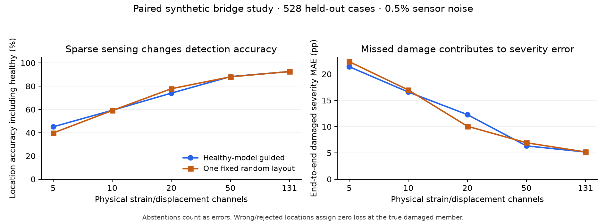

# STRATUM

**FEM-based damage estimation and sparse sensing in truss bridges**

**Author: [Atharv Sharma](AUTHORS.md)** · Research software portfolio

[](https://github.com/Valomaxed/stratum/actions/workflows/tests.yml)

**Academic review:** [Start here](START_HERE.md) · [Results](docs/RESULTS.md) · [Reproduce](docs/REPRODUCIBILITY.md) · [Architecture](docs/ARCHITECTURE.md)

Private repository: arrange access before sharing the CV link. [Reviewer access](docs/REVIEWER_ACCESS.md).

## Research question

How much damage-location and stiffness-loss information can be recovered from fewer structural-response channels in a simulated truss bridge?

STRATUM connects an implemented axial-truss FEM solver, prescribed moving-force dynamics, virtual strain/displacement sensing, random-forest estimators and an interactive 3D browser viewer. The study examines sensor-budget/accuracy trade-offs under a declared synthetic acquisition protocol.

## Implemented work

| Component | Implementation and review evidence |
|---|---|
| Structural mechanics | [2D/3D axial FEM](twin/fem.py), [bridge supports and axle transfer](twin/bridge.py), response and modal recovery |
| Dynamic acquisition | [Moving-force response](twin/bridge_dynamics.py), damping and complete-crossing channel histories |
| Damage estimation | [Scoped bridge RF pipeline](twin/bridge_learning.py); separate planar RF/physics inverse methods |
| Sparse experiment | [Selected-only features and paired placement study](twin/bridge_sparse.py) across five budgets |
| Interface | [Browser workspace](web/) with member inspection, load/deformation playback and exports; optional [Unity static viewer](unity/README.md) |
| Verification | [Analytical, balance, independent ODE and convergence checks](tests/); [support audit](data/support-review.md) |

NumPy/SciPy provide linear algebra and scikit-learn provides the random forests. Structural assembly, load transfer, acquisition/evaluation and visualization are implemented around those libraries. [Suggested source review route](START_HERE.md).

## Main finding: a sensor-budget trade-off

Saved results on the same **528 held-out synthetic cases** at **0.5% sensor noise**:

| Channels | Guided location accuracy | Fixed random accuracy | Guided damaged severity MAE (pp) |
|---|---:|---:|---:|
| 131 | 92.61% | 92.61% | 5.18 |
| 50 | 88.26% | 88.07% | 6.34 |
| 20 | 74.05% | 77.84% | 12.29 |
| 10 | 59.28% | 59.09% | 16.59 |
| 5 | 45.08% | 39.77% | 21.41 |



Fifty guided channels reduce channel count by **61.8%**, giving **88.26%** location accuracy versus **92.61%** for the full array. Only 131 guided channels met the predefined validation qualification rule. Guided placement did not outperform the single fixed random comparator at every budget.

Abstentions count as errors. End-to-end severity MAE includes missed/wrong locations; `pp` denotes percentage points of stiffness loss. Coverage, healthy alarms and complete definitions are in [Results](docs/RESULTS.md).

The study uses the same FEM family for training and test, healthy/single-member bridge damage and fixed crossing conditions. Healthy cases are noise replicates of one structural state. These results do not establish physical transfer.

## Fast review without training

After installing requirements.txt, run from the repository root:

```bash
python examples/quick_review.py
```

This compares healthy and configured-damaged static bridge responses and prints engineering values and equilibrium residuals. [Recorded output](data/review-example.json). No trained model or server is required for this example. [Reproduction levels](docs/REPRODUCIBILITY.md).

## Quick start

Python 3.12 or 3.13 is recommended for the documented development workflow. Run from a source checkout; the web assets and research artifacts live alongside the Python package.

```bash
git clone https://github.com/Valomaxed/stratum.git
cd stratum
python -m venv .venv
```

**Windows PowerShell**

```powershell
.\.venv\Scripts\python.exe -m pip install -r requirements.txt
.\.venv\Scripts\python.exe -m twin serve --host 127.0.0.1 --port 8766
```

**macOS / Linux**

```bash
.venv/bin/python -m pip install -r requirements.txt
.venv/bin/python -m twin serve --host 127.0.0.1 --port 8766
```

Open **http://127.0.0.1:8766/**. Select a structure, set loading and configured damage, then run the analysis. Use **Play crossing** for dynamics or **Use M05 · 40% loss** for a healthy/damaged comparison. [Unity setup](unity/README.md).

## Machine-learning artifacts

The repository includes source, tests, reports and previews. Trained forests and generated datasets are excluded. **FEM and visualization run without them; ML panels explicitly report unavailable until training is complete.**

```powershell
.\.venv\Scripts\python.exe -m twin train
.\.venv\Scripts\python.exe -m twin study
.\.venv\Scripts\python.exe -m twin robust-study
.\.venv\Scripts\python.exe -m twin bridge-train --workers 2
.\.venv\Scripts\python.exe -m twin bridge-sparse-study --workers 2
```

Sparse bridge training depends on the preceding bridge baseline. Training jobs can take several minutes or longer. [Experiment protocols, metrics and regeneration details](docs/RESEARCH.md).

## Validation

```powershell
.\.venv\Scripts\python.exe -m unittest tests.test_fem tests.test_space tests.test_bridge tests.test_bridge_dynamics tests.test_playback tests.test_pipeline tests.test_load_cases tests.test_robust tests.test_bridge_learning tests.test_bridge_sparse tests.test_support_audit -v
node --test tests/bridge-playback.test.cjs
.\.venv\Scripts\python.exe -m twin.support_audit
```

Tests cover analytical bars/tripods, support stability, force/moment and energy balance, modal equations, axle transfer, independent ODE comparisons, time-step convergence and inference contracts. Artifact-dependent tests skip explicitly when their local training files are absent. The optional legacy public-server adapter uses separate dependencies and tests; CI focuses on the local research application. No hosting or deployment is enabled by this repository setup.

## Repository map

| Path | Contents |
|---|---|
| `twin/` | FEM, bridge dynamics, sensing, estimators and HTTP API |
| `web/` | Browser workspace, plots and projected 3D model |
| `tests/` | Numerical, API/service and playback regression checks |
| `unity/` | Optional Unity project and static viewer |
| `hardware/` | Calibrated packet forwarding example |
| `data/` | Versioned reports/previews; generated large binaries ignored |
| `docs/` | Architecture, research protocol and repository migration |

## Research scope

The bridge is a linear, small-displacement axial-truss model. Deck mass/load transfer is included; local deck bending, contact/uplift, vehicle suspension/moving mass, nonlinear buckling, capacity and code checks are excluded. The displayed stiffness index is **not a structural safety rating**.

Bridge ML is validated on synthetic healthy/single-member loss cases within its declared default crossing and noise domain. Sparse dropout/drift, multi-member bridge damage and physical transfer are not established. Forest votes are uncalibrated. Only the full 131-channel guided layout met the study's predefined 90% validation target; fewer sensors trade accuracy for coverage. See [research notes](docs/RESEARCH.md) for the complete numerical results.

## Documentation and contributions

[Academic review](START_HERE.md) · [Results](docs/RESULTS.md) · [Reproduce](docs/REPRODUCIBILITY.md) · [Authorship](AUTHORS.md) · [Citation](CITATION.cff) · [Architecture](docs/ARCHITECTURE.md) · [Research](docs/RESEARCH.md) · [Support audit](data/support-review.md) · [Changelog](CHANGELOG.md) · [Contributing](CONTRIBUTING.md) · [Issues](https://github.com/Valomaxed/stratum/issues)
