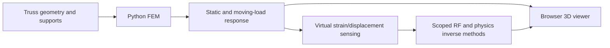

# Architecture

`twin/fem.py` assembles small-displacement axial truss stiffness and lumped mass for 2D/3D models. `bridge.py` adds bearings, dead load and panel-based axle transfer. `bridge_dynamics.py` integrates prescribed moving axle forces with all free bridge modes. `dynamics.py` supplies the shared linear Newmark integrator.

`sensors.py` and `load_cases.py` define calibrated virtual channels and acquisition protocols. `learning.py` and `robust.py` implement the planar estimators/inverse fits. `bridge_learning.py` and `bridge_sparse.py` load separately scoped dynamic bridge models and enforce acquisition contracts. Model artifacts remain local.

`server.py` serves the local viewer and APIs. `web/` is dependency-free HTML/CSS/JavaScript with a projected 3D canvas. The Unity client is separate and currently supports static analysis interactions. `hardware/bridge.py` forwards calibrated packets; it is not a complete physical instrumentation system.

Seismic frames are maintained in [stratum-seismic](https://github.com/Valomaxed/stratum-seismic). Neither repository imports the other. Research datasets, estimator scope and limitations are detailed in RESEARCH.md.
